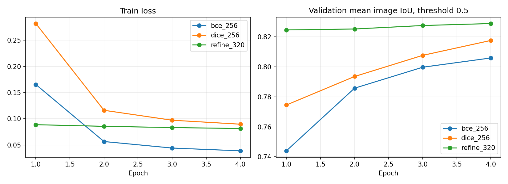
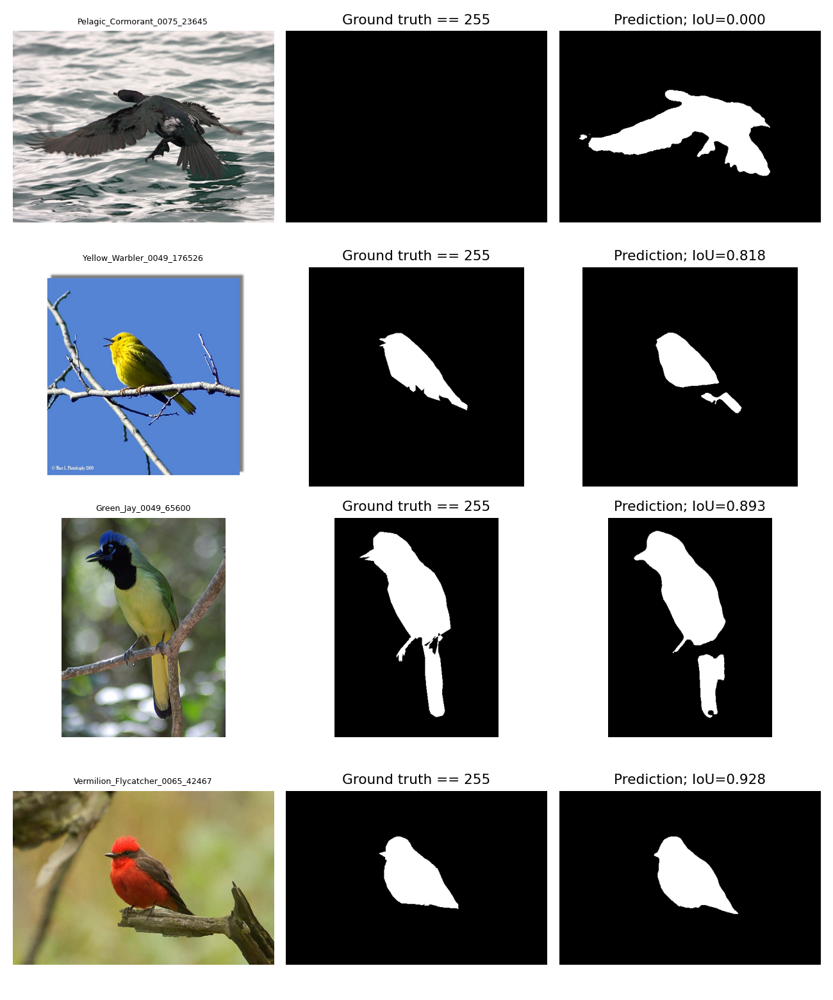

# Отчёт: сегментация птиц

Автор: Габидулин Андрей.

## Данные и протокол

Использован [архив задания](https://drive.google.com/file/d/10f1H2T-5W-BiqabHHtlZ4ASs19TZmg8R/view). Исходное разделение сохранено: train — 8 382 пары, val — 1 406 пар; по 200 папок птиц. Общих относительных имён и SHA256 изображений между частями нет. В train есть 5 одноканальных изображений; они преобразуются в RGB. Две маски train имеют режим LA: используется первый канал.

Во всех исходных масках есть промежуточные значения. По условию и подтверждённому уточнению автора работы птица определяется **только значением 255** в первом канале; остальные значения становятся фоном. После этого пустыми оказываются 279 масок train и 49 масок val. Это существенная особенность целевой разметки; переход к `>127` изменил бы задачу и метрику. Полный аудит: [data_audit.json](results/data_audit.json), контрольная сумма архива: [data_archive.json](results/data_archive.json).

Весовые обновления выполняются только на train. Validation используется для выбора лучшей эпохи, варианта обучения и порога. Закрытый набор не использовался. Оценка — среднее IoU по изображениям в исходном разрешении, без взвешивания по площади. Две пустые маски дают IoU=1, одна пустая — 0.

## Предобработка и архитектура

Изображение масштабируется с сохранением пропорций и дополняется до квадрата. Интерполяция изображения — bilinear, маски — nearest. Padding RGB=(124,116,104); нормализация ImageNet mean/std. Горизонтальное отражение и поворот применяются одинаково к изображению и маске; ColorJitter меняет только изображение.

Энкодер — [ResNet18 с весами IMAGENET1K_V1](https://docs.pytorch.org/vision/stable/models/generated/torchvision.models.resnet18.html). Его классификационная голова удалена. Пространственные масштабы признаков: 64×H/2, 64×H/4, 128×H/8, 256×H/16, 512×H/32.

Декодер реализован самостоятельно в `src/model.py`: bilinear upsampling до размера skip, конкатенация, два Conv3×3+BatchNorm+ReLU. Выходные каналы блоков: 128, 64, 32, 16, 16. Последний блок также получает 16 полноразмерных признаков собственной DoubleConv от входа. Финальная Conv1×1 выдаёт один логит на пиксель. Всего 12 465 985 параметров. Декодер и полноразмерная ветвь исходно случайные; предобучен только разрешённый ImageNet-энкодер.

Обучение — AdamW, weight decay=1e-4, cosine scheduler, gradient clipping=1. Для первых двух запусков энкодер заморожен на первой эпохе, включая BatchNorm. Базовая потеря — BCEWithLogits. Вторая потеря:

`L = 0.5 BCEWithLogits + 0.5 mean_i(1 - (2 Σ(p_i y_i)+1)/(Σp_i+Σy_i+1))`, где `p=sigmoid(logits)`.

Dice рассчитывается по каждому изображению, включая пустые маски. Зерно 42; зерно каждой эпохи и shuffle определяются номером эпохи. Обучение: Apple M3 Pro, 36 GiB RAM, MPS, FP32. Все зависимости и версии — в [environment.json](results/environment.json).

## Эксперименты

| Запуск | Размер | Потеря | Лучшая эпоха | Val mean IoU, t=0.5 | Время эпох с val |
|---|---:|---|---:|---:|---:|
| bce_256 | 256 | BCE | 4 / 4 | 0.805857 | 6.40 мин |
| dice_256 | 256 | 0.5 BCE + 0.5 Dice | 4 / 4 | 0.817523 | 6.44 мин |
| refine_320 | 320 | 0.5 BCE + 0.5 Dice | 4 / 4 | 0.828784 | 13.05 мин |

Выбран `refine_320`, эпоха 4. После подбора порога **t=0.40: mean IoU=0.829020**. При t=0.5: 0.828784. Сетка: [thresholds.csv](results/thresholds.csv).

Повторная оценка готовых весов на CPU: PyTorch **0.829020**, ONNX **0.829020**, по 1406 изображениям. Результаты каждого изображения сохранены в `results/val_pytorch.csv` и `results/val_onnx.csv`.

Время таблицы включает обучение и валидацию внутри эпох; подготовка RAM-кеша и сериализация чекпойнтов в него не включены. Все конфигурации завершили 4 эпохи. `refine_320` — ещё 4 эпохи после выбранной эпохи `dice_256`.

Веса: [GitHub Release v1.0](https://github.com/andreygabi/birds-segmentation-hw/releases/tag/v1.0). SHA256 и прямые ссылки: [weights_manifest.json](results/weights_manifest.json).

Первые два запуска имеют одинаковые исходные веса, seed, данные, аугментации и настройки; меняется потеря. Третий инициализирован собственным лучшим Dice-чекпойнтом и использует новый AdamW. В нём одновременно изменяются разрешение, аугментации и learning rate, поэтому их отдельный вклад эксперимент не изолирует. Сравнение всех вариантов проводится по одной метрике и одним изображениям.

Чекпойнт выбирается при пороге 0.5. Затем только для выбранной модели проверяется сетка порогов 0.30–0.70 с шагом 0.05. При равном IoU выбирается больший порог. Фактическая конфигурация, выбранная эпоха и родительский запуск сохранены в [selected_config.yaml](results/selected_config.yaml).

На графике слева значения разных функций потерь имеют разные шкалы и не являются прямой оценкой превосходства модели. Справа приведён сопоставимый mean IoU при пороге 0.5.

Примеры выбраны по позициям 0%, 20%, 50%, 80% в упорядоченном списке val IoU. Они включают плохие и типичные предсказания, а не только удачные случаи.

При пороге 0.4 для 49 пустых целевых масок mean IoU=0: модель выделяет птицу на этих фотографиях. Для 257 изображений с площадью цели до 5% mean IoU=0.760134; для площади 5–15% — 0.876379, свыше 15% — 0.897359. Размер объекта и пустая цель заметно влияют на итоговое среднее. Полные значения: [iou_by_area.csv](results/iou_by_area.csv).

## Предсказание и постпроцессинг

Предсказание принимает только каталог изображений. Из логитов удаляется padding, после чего они интерполируются до исходного H×W. Затем sigmoid, выбранный порог и запись одноканального PNG 0/255. Относительное имя и подпапки сохраняются. Морфология, поиск компонентов и test-time augmentation не используются.

Порог вероятности можно заменить математически эквивалентным порогом логита `log(t/(1-t))`. Просто применять число `t` к логитам некорректно. Без восстановления исходной геометрии сравнение масок разных размеров не определено.

На val при корректной обработке IoU=0.829020. Если ошибочно сравнить исходные логиты с числом 0.40 вместо вероятностей, IoU=0.827977. Для масштаба: всегда фон даёт 0.034851, всегда птица — 0.105908.

## Ускоренный инференс

Экспорт ONNX, opset 17, FP32, динамический batch, фиксированный размер изображения. При экспорте BatchNorm свёрнуты в Conv; ONNX Runtime CPUExecutionProvider дополнительно оптимизирует граф и его исполнение. Подход не требует дополнительного обучения или изменения разметки. [Документация ONNX Runtime](https://onnxruntime.ai/docs/performance/tune-performance/).

Базовый PyTorch тоже работает в `eval()` и `inference_mode()`. В обоих случаях CPU Apple M3 Pro, FP32, NCHW, 6 intra-op / 1 inter-op поток, одни и те же заранее подготовленные 64 тензора val. Для batch 1,4,8: два полных прогрева и три полных замера, медиана. Таймер включает только forward; чтение файлов, преобразования и запись масок исключены. Во время замера обучение не выполняется. Замеры CPU синхронны; сравнение с GPU или AMP не проводится.

| Batch | PyTorch, с / 64 | ONNX, с / 64 | Ускорение |
|---:|---:|---:|---:|
| 1 | 3.2249 | 1.8345 | 1.76× |
| 4 | 3.9422 | 2.4458 | 1.61× |
| 8 | 3.9601 | 2.6273 | 1.51× |

Наибольшая пропускная способность ONNX — при batch=1: 34.89 изображений/с; ускорение относительно PyTorch с тем же batch **1.76×**. Максимальное абсолютное расхождение логитов: 7.1e-05. Различающиеся пиксели после порога: 0 из 31610523 проверенных (по всем batch size). Полные времена, ID входов и настройки: [benchmark.json](results/benchmark.json).

Результаты относятся к этому CPU и данному размеру входа. Они не означают такое же ускорение всего процесса чтения изображений и записи масок. Команды воспроизведения и повторного экспорта приведены в README.

## Ограничения

Validation используется для выбора вариантов и порога, поэтому его результат не является независимой оценкой на новых данных. Промежуточные значения исходных масок по буквальному условию исключены из птицы; это уменьшает целевую область и иногда даёт пустую маску на фотографии птицы. Уменьшение изображений может терять мелкие детали. Проверены три конфигурации; отдельная абляция разрешения и сильных аугментаций не проводилась.
